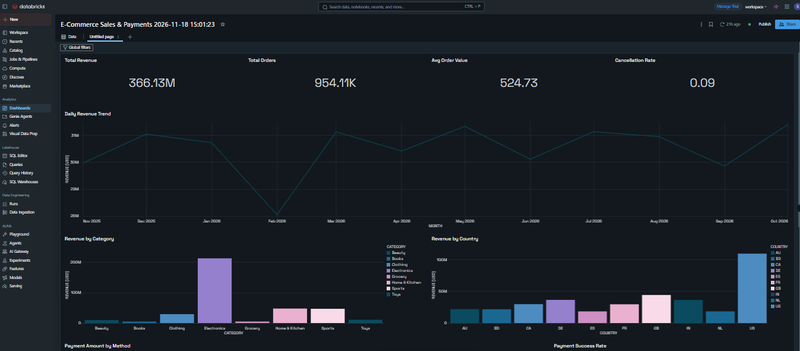
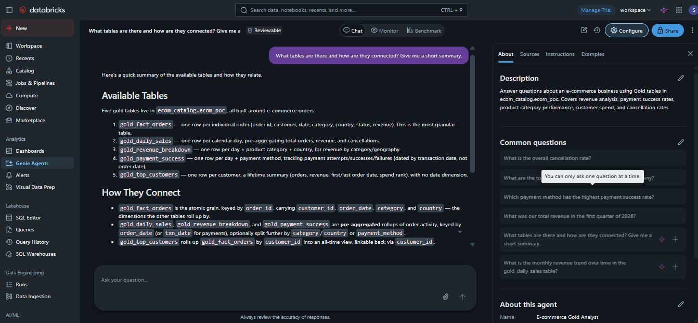
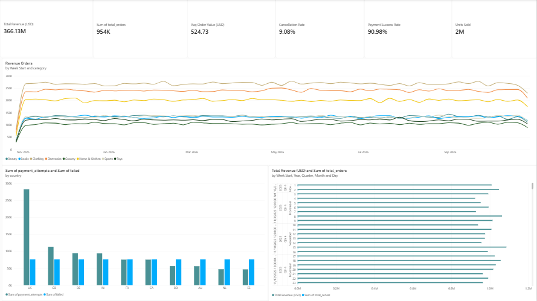
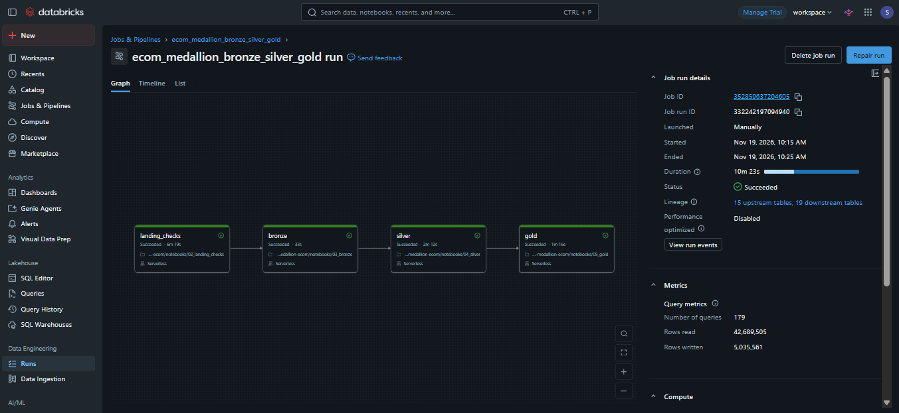
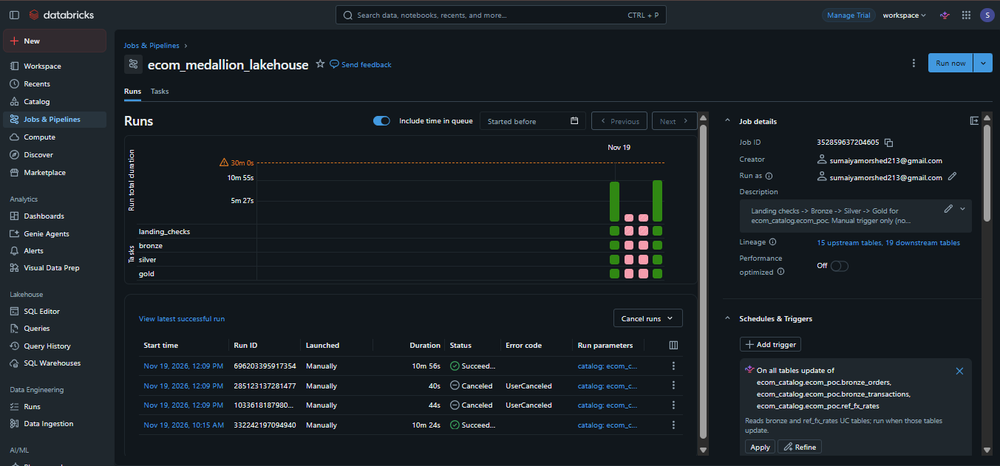

# E-commerce Lakehouse: Databricks Medallion Pipeline

A Bronze, Silver and Gold pipeline on Databricks that turns raw order and payment extracts into a single, documented revenue metric shared by an AI/BI dashboard, a Genie agent and Power BI.

```
generator (seed 42) -> orders.csv, transactions.csv (1,000,000 rows each)
        |  upload
        v
Unity Catalog volume   /Volumes/ecom_catalog/ecom_poc/raw_files/
        |  03_bronze    all STRING, audit columns, idempotent per batch
        v
bronze_orders, bronze_transactions
        |  04_silver    safe parse, validate, deduplicate
        v
silver_* (accepted), silver_*_quarantine, silver_*_duplicates
        |  05_gold      aggregate payments per order, then 1:1 join
        v
gold_fact_orders -> gold_daily_sales, gold_revenue_breakdown,
                    gold_payment_success, gold_top_customers
        |  one SQL warehouse
        v
AI/BI dashboard, Genie agent, Power BI (Import)
```

## Overview

Daily CSV extracts of orders and payments contain nulls, text in numeric fields, inconsistent labels, invalid or future timestamps, orphan payments and duplicates. Reports built directly on them disagree. This project:

- keeps the raw data unchanged (landing and Bronze);
- applies explicit, counted validation rules without silently dropping rows (Silver);
- publishes one revenue definition that every reporting tool reuses (Gold).

## Environment

| Item | Value |
|---|---|
| Platform | Databricks free trial (14 days, started 2026-11-16) |
| ETL compute | Serverless notebooks |
| BI compute | Serverless SQL warehouse, smallest size, 10-minute auto-stop |
| Catalog / schema | `ecom_catalog` / `ecom_poc` |
| Landing volume | `/Volumes/ecom_catalog/ecom_poc/raw_files/` |
| Repository | <https://github.com/morshed11s/databricks-medallion-ecom> (connected as a Databricks Git folder) |

The trial was chosen over Free Edition because the project needs Unity Catalog administration, a SQL warehouse endpoint for Power BI, and Lakeflow Jobs. Serverless notebooks suit the batch ETL work and bill only while code runs. One small warehouse serves all BI consumers. The job has no schedule, Power BI uses Import mode, and the warehouse auto-stops.

### Naming

| Object | Pattern | Example |
|---|---|---|
| Tables | `<layer>_<entity>` | `bronze_orders`, `gold_daily_sales` |
| Rejected / duplicate rows | `silver_<entity>_quarantine`, `_duplicates` | `silver_orders_quarantine` |
| Reference / operational tables | `ref_<name>`, `ops_<name>` | `ref_fx_rates`, `ops_bronze_load_log` |

The catalog name is a single notebook and job parameter (`catalog`).

### Design principles

- Each rule is defined once. Validation rules live in `04_silver` (materialised as `ref_dq_rules`). Revenue is defined only in `gold_fact_orders.revenue_usd`; downstream tools sum that column and never re-derive it.
- Rates are stored with numerator and denominator and re-aggregated as `SUM/SUM`, never `AVG(rate)`.
- Money is `DECIMAL` and dates are `DATE`.
- Every notebook is safe to re-run and stops on a failed invariant. [`sql/10_quality_assertions.sql`](sql/10_quality_assertions.sql) re-checks them independently.

## Source data

[`generator/generate_data.py`](generator/generate_data.py) uses only the Python standard library and seed 42. It writes 1,000,000 data rows per file, and the same seed always yields identical bytes (sha256 in [`generator/manifest.json`](generator/manifest.json)). Each row carries at most one injected anomaly, so counts are exact. Full inventory: [`generator/dirty_data_report.md`](generator/dirty_data_report.md).

| Anomaly | orders.csv | transactions.csv |
|---|---|---|
| Null or blank values | 10,119 | 9,888 |
| Text in numeric fields | 8,051 | 8,104 |
| Negative or out-of-range numbers | 7,947 | 7,008 |
| Invalid timestamps / future timestamps | 3,973 / 3,003 | 4,021 / 2,920 |
| Inconsistent case or whitespace | 29,834 | 29,662 |
| Exact duplicates / key conflicts | 5,001 / 4,862 | 4,993 / 4,985 |
| Invalid status labels | 2,939 | 2,028 |
| Orphan order IDs | n/a | 10,216 |
| Unsupported currency | n/a | 4,027 |
| **Total anomalous rows** | **75,729 (7.57%)** | **87,852 (8.79%)** |

Anomalies are kept to a small, measured share so the data resembles production extracts, Silver's rejection counts can be verified against the generator, and the remaining rows still support meaningful analytics.

| File | Rows | Bytes |
|---|---|---|
| orders.csv | 1,000,000 | 66,468,913 |
| transactions.csv | 1,000,000 | 71,233,922 |

`02_landing_checks` verifies each uploaded file's sha256 against the manifest and records the result in `ops_landing_file_log`.

### Repository hygiene

Real data, credentials and raw extracts do not belong in Git: history is permanent, copied to every clone, and cannot be fully retracted. [`.gitignore`](.gitignore) excludes CSV and Parquet files, `.env`, token files and `.databrickscfg`, and only synthetic data is used. For production, add secret scanning with push protection, store secrets in Databricks secret scopes or use OAuth service principals, restrict non-production environments to synthetic or masked data, and protect the main branch with required review.

## Bronze

Notebook: [`notebooks/03_bronze.py`](notebooks/03_bronze.py). Checks: [`sql/02_bronze_checks.sql`](sql/02_bronze_checks.sql).

All source fields are loaded as STRING with an explicit schema (no inference). Malformed values arrive exactly as sent, and a structurally broken line fails the load (`FAILFAST`) rather than being dropped. Keeping bad values lets the team count them, explain them, return them to the source owner and reprocess after a rule change.

| Column | Purpose |
|---|---|
| `_ingested_at` | Load timestamp |
| `_source_file` | Volume path of the source CSV |
| `_source_line` | 1-based data row number in the file |
| `_batch_id` | `<file>:<sha256 prefix>`; same content gives the same batch (idempotency key) |
| `_row_hash` | sha256 of all source columns; equal hash means an exact duplicate |
| `_bronze_row_id` | `<_batch_id>#<_source_line>`; unique id carried into every Silver outcome |

The notebook compares the file's line count with the Bronze row count for the batch and fails on a mismatch. Writes use Delta `replaceWhere _batch_id = ...`, so re-running the same file replaces the batch instead of appending to it. A file with different content becomes a new batch.

## Silver

Notebook: [`notebooks/04_silver.py`](notebooks/04_silver.py). Checks: [`sql/03_silver_checks.sql`](sql/03_silver_checks.sql).

Processing order:

1. **Standardise.** Trim, upper-case codes, treat empty strings as missing. Case and whitespace issues are corrected, not rejected.
2. **Parse safely.** `try_cast` and `try_to_timestamp` with strict formats return NULL instead of failing. The raw string is kept beside the parsed value.
3. **Validate.** All rules are evaluated and every failure is recorded in `rejection_reasons`. Any failure sends the row to quarantine.
4. **Deduplicate valid rows only.** One deterministic winner per key.

Because validation precedes deduplication, a row that is both invalid and duplicated is counted once, in quarantine. The three outcomes therefore partition Bronze.

### Validation rules

Stored in `ref_dq_rules`; per-rule counts in `ops_silver_rule_counts`.

| Dataset | Rules |
|---|---|
| orders | all 8 fields mandatory; `order_date` valid and not in the future; `quantity` whole number 1-100; `unit_price` decimal in (0, 100,000]; `category` one of 8 values; `order_status` in COMPLETED, SHIPPED, PENDING, CANCELLED, RETURNED; `country` in US, GB, DE, FR, IN, CA, AU, BD, NL, ES |
| transactions | all 7 fields mandatory; `amount` decimal in (0, 1,000,000]; `txn_ts` valid and not in the future; `currency` in USD, EUR, GBP; `payment_method` in CARD, PAYPAL, WALLET, BANK_TRANSFER, COD; `txn_status` in SUCCESS, FAILED, PENDING, REFUNDED; `order_id` must exist in accepted `silver_orders` |

The orphan check uses accepted orders, so a payment for a quarantined order is also quarantined.

### Deduplication

| Dataset | Key | Winner |
|---|---|---|
| orders | `order_id` | Latest `_source_line` |
| transactions | `txn_id` | Latest `txn_ts`, ties broken by latest `_source_line` |

Both orderings are total, so results are deterministic. Each loser records its `winner_bronze_row_id` and a `duplicate_type`: `exact_row_duplicate` (same `_row_hash`) or `key_conflict` (same key, different content).

### Reconciliation

`ops_silver_reconciliation` proves, by `_bronze_row_id`, that counts add up, no id appears in two outcomes, and no Bronze id is unassigned.

| Dataset | Bronze | Accepted | Quarantined | Duplicates | Overlap |
|---|---|---|---|---|---|
| orders | 1,000,000 | 954,105 | 36,032 | 9,863 | 0 |
| transactions | 1,000,000 | 941,810 | 48,212 | 9,978 | 0 |

## Gold

Notebook: [`notebooks/05_gold.py`](notebooks/05_gold.py). Metric queries: [`sql/04_gold_metrics.sql`](sql/04_gold_metrics.sql).

### Revenue definition

Revenue (USD) is the order value (`quantity * unit_price`) of each order that meets both conditions:

1. `order_status` is COMPLETED or SHIPPED.
2. The order is fully paid: its SUCCESS payments, converted to USD with `ref_fx_rates`, sum to at least the order value (0.05 USD tolerance for FX rounding).

Failed, pending and refunded payments do not count as paid. Split payments are summed. Repeat charges cannot inflate revenue because revenue uses order value rather than payment totals; the excess is reported as `overpaid_usd`. Revenue is dated by `order_date`.

| Order | Status | Value | Successful payments | Revenue |
|---|---|---|---|---|
| A | COMPLETED | 100 | 100 | 100 |
| B | COMPLETED | 100 | 50 + 50 | 100 |
| C | SHIPPED | 100 | 100 + 100 | 100 (overpaid 100) |
| D | COMPLETED | 100 | FAILED, then 100 | 100 |
| E | CANCELLED | 100 | REFUNDED | 0 |
| F | COMPLETED | 100 | none | 0 |

### Tables

Payments are aggregated to one row per order before joining, which prevents fan-out. The notebook asserts that `gold_fact_orders` has the same row count as `silver_orders` and that revenue is identical across all marts.

| Table | Grain | Key | Notes |
|---|---|---|---|
| `gold_fact_orders` | order | `order_id` | `revenue_usd`, `paid_usd`, `is_revenue_eligible`, `overpaid_usd` |
| `gold_daily_sales` | day | `order_date` | Revenue, orders, cancellation counts |
| `gold_revenue_breakdown` | day, category, country | `(order_date, category, country)` | Revenue, units, orders |
| `gold_payment_success` | payment day, method | `(txn_date, payment_method)` | Success rate = SUCCESS / (SUCCESS + FAILED); pending and refunded excluded |
| `gold_top_customers` | customer, lifetime | `customer_id` | Revenue, AOV, rank; not date-filterable |

Table and column comments and informational primary keys are written to Unity Catalog, so they appear in Catalog Explorer, Genie and BI tools.

## AI/BI dashboard and Genie

Both read the Gold tables only, through the shared warehouse.

**Dashboard: "E-Commerce Sales & Payments".** Datasets: [`sql/05_dashboard_datasets.sql`](sql/05_dashboard_datasets.sql). It has KPI counters (revenue, orders, average order value, cancellation rate, payment success rate), a revenue trend, breakdowns by category, country and payment method, and global filters for date, category and country. Ratios are computed as `SUM/SUM` so they remain correct under filters. The category and country filters apply to revenue widgets only, and the top-customers table is lifetime.



**Genie agent: "E-commerce Gold Analyst".** Configured over the five Gold tables with instructions that revenue is `SUM(revenue_usd)`, rates are ratios of sums, `country` holds ISO-2 codes, and lifetime customer data is not date-filterable. Reference queries for checking its answers are in [`sql/06_genie_verification.sql`](sql/06_genie_verification.sql).



## Power BI

Measures: [`powerbi/measures.dax`](powerbi/measures.dax). Report: [`powerbi/PowerBi_Report.pbix`](powerbi/PowerBi_Report.pbix).



The report connects with the native Databricks connector in **Import** mode, using the warehouse's server hostname and HTTP path. Import suits small Gold aggregates that change once per pipeline run: interactions are fast and the warehouse can auto-stop, whereas DirectQuery would keep it running and is only warranted for near-real-time or very large data. Access tokens are never committed.

The model uses a calculated `Date` table related to `order_date` and `txn_date`, dates typed as Date, and money as fixed decimal. Six measures (Total Revenue, Revenue Orders, Avg Order Value, Units Sold, Cancellation Rate, Payment Success Rate) mirror the dashboard definitions.

### Cross-tool check

All three tools sum `revenue_usd`. Query: [`sql/07_cross_tool_revenue_check.sql`](sql/07_cross_tool_revenue_check.sql).

| Measure | AI/BI dashboard | Power BI |
|---|---|---|
| Total revenue (USD) | 366.13M | 366.13M |
| Average order value | 524.73 | 524.73 |
| Cancellation rate | 9.08% | 9.08% |

If figures differ, check in order: date filter mismatch, residual category or country filter, date columns imported as datetime or shifted by timezone, floating-point instead of fixed decimal, a stale Import refresh, or a different revenue definition.

## Orchestration and access control

**Lakeflow Job** ([`lakehouse/lakeflow_job.yaml`](lakehouse/lakeflow_job.yaml)): `landing_checks` -> `bronze` -> `silver` -> `gold` on serverless compute.



| Setting | Value |
|---|---|
| `landing_checks` | No retry; fails on a missing file or sha256 mismatch |
| `bronze`, `silver`, `gold` | One retry after 2 minutes; all tasks are safe to re-run |
| Timeouts | 30 min landing and Gold, 60 min Bronze and Silver, 2 h job |
| Duration warning | 30 minutes |
| Concurrency | Queue enabled, one run at a time |
| Notifications | Email on start, success, failure and duration warning |
| Trigger | None (manual runs only) |

Each task runs only if its upstream tasks succeed, so a failed Silver reconciliation prevents Gold from rebuilding on incomplete data, and the last good Gold tables remain in place. Two complete runs succeeded (about 10.5 minutes each).



**Least-privilege access** ([`sql/08_grants.sql`](sql/08_grants.sql)): the `ecom_reporting` group receives `USE CATALOG`, `USE SCHEMA` and `SELECT` on the five Gold tables, plus warehouse access. It has no access to Bronze, Silver, ops tables or the landing volume. The pipeline owner retains full rights.

## Trial limitations

| Area | Status |
|---|---|
| Catalog creation | `01_setup` runs `CREATE CATALOG IF NOT EXISTS`; if blocked, create it in Catalog Explorer |
| Serverless notebooks, Lakeflow Jobs, AI/BI, Genie, email notifications | Available and used |
| Reporting group and extra users | Not verified; `sql/08_grants.sql` is the intended grant set |

## Reproducing the project

1. Run `python generator/generate_data.py` and confirm the output hashes match `generator/manifest.json`.
2. Clone the repository into Databricks as a Git folder.
3. Run `notebooks/01_setup`, then upload both CSVs to `/Volumes/ecom_catalog/ecom_poc/raw_files/` (setup copies them from `/Volumes/workspace/ecom_poc/raw_files/` if present).
4. Run `02_landing_checks`, `03_bronze`, `04_silver` and `05_gold`, or run the Lakeflow Job after setting your own email and Git folder path.
5. Build the dashboard and Genie agent from `sql/05` and `sql/06`, and the Power BI report from `powerbi/measures.dax`.

## Repository layout

| Path | Contents |
|---|---|
| `generator/` | Seeded generator, dirty-data report, manifest |
| `notebooks/` | Config, setup, landing checks, Bronze, Silver, Gold, Power BI export fallback |
| `sql/` | Setup, verification, metric, dashboard, grant and assertion queries |
| `genie/` | Dashboard and Genie screenshots |
| `powerbi/` | Report, screenshot, DAX measures |
| `lakehouse/` | Job definition and run evidence |
